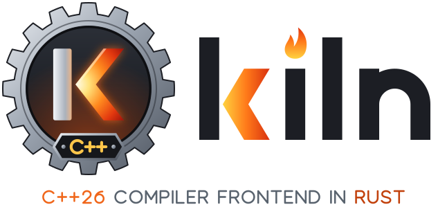

<p align="center">
  <picture>
    <source media="(prefers-color-scheme: dark)" srcset="assets/logo/kiln-banner-dark.svg">
    
  </picture>
</p>

# kiln

**A C++26 compiler frontend in safe Rust, built around a constexpr oven.**

kiln compiles C++26 source to LLVM IR and leaves optimization, code
generation and linking to LLVM. It exists for compile-time evaluation:
constexpr, consteval and C++26 reflection code that makes compilers slow
and memory-hungry today. kiln's constant evaluator, the Oven, was designed
for that work from the start, and the test suite tracks its wall-clock
time and peak memory. Every crate is `#![forbid(unsafe_code)]`, and kiln
has no LLVM FFI: it writes IR as text and runs LLVM's tools. On the
command line and in its predefined macros kiln looks like clang, so build
systems and standard libraries work with it unchanged.

## Numbers

Each number links to the page that records how it was measured.

- **Constant evaluation.** On kiln's benchmark corpus, compared with
  clang 19 (37 entries, aarch64, 2026-11-03): geometric mean **0.21x**
  clang's time and **0.17x** its peak memory. Constexpr-bound entries such
  as `oven/fib` (0.05x) and `oven/churn-vector` (0.03x) gain the most.
  [docs/status/perf.md](docs/status/perf.md)
- **Constexpr-heavy libraries.** Built per TU against a control compiler
  (ctre, mp-units, daw_json_link, Glaze, scnlib, reflect-cpp): **0.39x to
  0.47x** the control's peak RSS (geomean per project), at 0.91x to 1.06x
  its time. [docs/COMPATIBILITY.md](docs/COMPATIBILITY.md#constexpr-and-compile-time-performance)
- **libc++ 22.1.8** test suite (9247 tests, `-std=c++26`): **99.2%**
  pass. [docs/COMPATIBILITY.md](docs/COMPATIBILITY.md#standard-libraries),
  [docs/status/libcxx-m5.md](docs/status/libcxx-m5.md)
- **47 open-source projects** built with their own build systems and test
  suites: 43 Flawless, 3 Near-perfect, 1 Partial. They include all of LLVM
  (`check-llvm`: 38434 tests passed, at 0.94x clang's summed TU time and
  0.63x its peak TU RSS), Boost and folly.
  [docs/COMPATIBILITY.md](docs/COMPATIBILITY.md#libraries-and-applications)
- **Language support:** 257 of 260 rows of the C++98 to C++26 paper table
  are done and 3 are partial.
  [docs/STANDARD_SUPPORT.md](docs/STANDARD_SUPPORT.md)

## Quick start

kiln runs on Linux, on aarch64 and x86_64. Release archives are attached
to each [GitHub release](https://github.com/christopherfretz/kiln/releases):
`kiln-<version>-<triple>.tar.xz`, a `-symbols` archive with full debug
information, and `SHA256SUMS`.

```sh
sha256sum -c --ignore-missing SHA256SUMS
tar -xJf kiln-<version>-<triple>.tar.xz
export PATH=$PWD/kiln-<version>-<triple>/bin:$PATH
```

The tree is relocatable: `bin/kiln`, `bin/kiln++`, the builtin headers
and predefines in `lib/kiln/<major>/`, and the documentation in
`share/doc/kiln/`.

kiln needs an LLVM installation with clang at run time, for `opt`, `llc`,
`llvm-as` and the `clang++` that links, plus libstdc++ (or libc++).
LLVM 22 (preferred) and LLVM 19 are supported. kiln finds an installation
in the usual places on its own. `--llvm-dir=<dir>` or `KILN_LLVM_DIR`
names one, and `kiln++ --version` prints the choice. On Debian 13:

```sh
sudo apt install clang-19 llvm-19 g++    # LLVM 19 from Debian's archive, and libstdc++
```

LLVM 22 comes from [apt.llvm.org](https://apt.llvm.org). The packages
for Ubuntu and Fedora are in
[docs/COMPATIBILITY.md](docs/COMPATIBILITY.md#runtime-dependencies).

Then compile:

```sh
kiln++ -std=c++26 hello.cpp -o hello && ./hello
CXX=kiln++ cmake -S . -B build && cmake --build build
```

CMake identifies kiln as Clang and needs no changes. Autotools works
unchanged too. Meson needs a wrapper. The
[user guide](docs/USER_GUIDE.md) covers installation, build systems,
language modes, Oven limits and flags.

## Building from source

The Rust toolchain is pinned in `rust-toolchain.toml` (Rust 1.95.0, which
is also the MSRV). The backend and the test oracles need clang and LLVM 22
and 19 (`/usr/lib/llvm-22` and `/usr/lib/llvm-19`, with `clang++-22` and
`clang++-19` on `PATH`), which is what CI installs.

```sh
cargo build --release              # target/release/kiln and kiln++
cargo xtask ci --quick             # fmt, clippy, unit tests, the corpus through kiln
cargo xtask dist                   # release archives, as published, from this checkout
```

`cargo xtask dist --check` also extracts the archive and smoke-tests it.
The archive layout is in [spec/driver.md](spec/driver.md) under
"Installation layout".

## Status

kiln is preparing its 1.0 release (version 0.0.1 until then). The
current milestone, M8, builds real open-source projects with kiln. The
milestones are in [docs/ROADMAP.md](docs/ROADMAP.md).

| Area | State | Detail |
|---|---|---|
| C++98 to C++23 | done | [STANDARD_SUPPORT.md](docs/STANDARD_SUPPORT.md) |
| C++26 (Croydon DIS draft), reflection, contracts | done except 1 partial paper (P2786, removed from the DIS) | [STANDARD_SUPPORT.md](docs/STANDARD_SUPPORT.md) |
| libc++ 22 / libc++ 19 / libstdc++ 14 | 99.2% / 98.3% / every header | [COMPATIBILITY.md](docs/COMPATIBILITY.md#standard-libraries) |
| Debug info, sanitizers, gcov and source coverage | supported; gaps listed | [KNOWN_ISSUES.md](docs/KNOWN_ISSUES.md) |
| Modules | supported, with module files and CMake dependency scanning; no header-unit module files yet | [USER_GUIDE.md](docs/USER_GUIDE.md#modules) |
| C | preprocessing only | [KNOWN_ISSUES.md](docs/KNOWN_ISSUES.md#c-mode) |
| Platforms | Linux aarch64, Linux x86_64 | [KNOWN_ISSUES.md](docs/KNOWN_ISSUES.md#platforms) |

## Documentation

For users:

- [docs/USER_GUIDE.md](docs/USER_GUIDE.md): installing, build systems,
  language modes, the Oven, flags, environment variables, debugging.
- [docs/KNOWN_ISSUES.md](docs/KNOWN_ISSUES.md): what does not work yet.
- [docs/COMPATIBILITY.md](docs/COMPATIBILITY.md): every library and
  project kiln was tested against, with results.
- [docs/STANDARD_SUPPORT.md](docs/STANDARD_SUPPORT.md): the language
  features, paper by paper.
- [docs/STABILITY.md](docs/STABILITY.md): what a version number promises.
- [docs/REPORTING-BUGS.md](docs/REPORTING-BUGS.md): crash reports and
  reproducers. Security issues: [SECURITY.md](SECURITY.md).
- [CHANGELOG.md](CHANGELOG.md).

For contributors:

- [CONTRIBUTING.md](CONTRIBUTING.md): building, testing and sending
  changes.
- [docs/ARCHITECTURE.md](docs/ARCHITECTURE.md): the crate pipeline and the
  Oven's design.
- [spec/](spec/): one contract per crate.
- [docs/ROADMAP.md](docs/ROADMAP.md),
  [docs/BACKLOG.md](docs/BACKLOG.md): milestones and work packages.

## Layout

| Path | What |
|---|---|
| `crates/kiln_source`, `kiln_diag` | source management, diagnostics |
| `crates/kiln_lex`, `kiln_pp` | translation phases 1–4 |
| `crates/kiln_ast`, `kiln_parse`, `kiln_sema` | syntax and semantics |
| `crates/kiln_oven` | the constant evaluator |
| `crates/kiln_abi`, `kiln_llvm`, `kiln_codegen` | Itanium ABI, IR model, lowering |
| `crates/kiln_driver` | the `kiln` and `kiln++` commands |
| `xtask/` | test, bench, libc++, OSS and release harness (`cargo xtask ...`) |
| `spec/` | per-crate contracts |
| `docs/` | user and contributor documentation, status pages |
| `resource/` | clang's builtin headers and predefined macro sets |
| `tests/`, `bench/` | conformance and differential corpus, perf corpus |

## Development

kiln is written by agents working on work packages, coordinated by a
supervisor. Their contract is [docs/AGENTS.md](docs/AGENTS.md). The test
layers, the test directive format and perf tracking are described in
[docs/VALIDATION.md](docs/VALIDATION.md). Human contributors start with
[CONTRIBUTING.md](CONTRIBUTING.md).

## Reporting bugs

File issues at https://github.com/christopherfretz/kiln/issues. When kiln
crashes it prints an "internal compiler error" report and writes a
reproducer: a preprocessed `.ii` and a `.sh` that reruns the command.
Attach both. See [docs/REPORTING-BUGS.md](docs/REPORTING-BUGS.md).

## License

Dual-licensed under MIT ([LICENSE-MIT](LICENSE-MIT)) or Apache-2.0
([LICENSE-APACHE](LICENSE-APACHE)), at your option. `resource/include` is
a copy of clang's builtin headers under the Apache-2.0 with LLVM
exceptions license; see `resource/include/LICENSE.TXT`.
